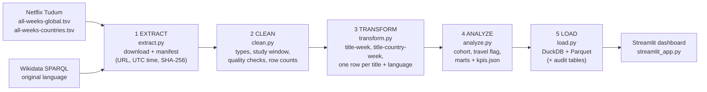

# Which non-English Netflix titles travel?

**A five-stage Python data pipeline (extract → clean → transform → analyze → load) on Netflix's official Top 10 data, ending in a Streamlit dashboard.**
**Live dashboard:** [netflix-top10-travel.streamlit.app](https://netflix-top10-travel.streamlit.app/)  
Status: **initial prototype** · Author: [Mohammad Amir Khan](https://github.com/amirator)


| | |
|---|---|
| **Business question** | Which non-English titles *travel*, meaning they chart in many countries for many weeks? What do they have in common: film or TV, language, weeks to peak, countries reached? |
| **Finding** | Only **$travellers of $cohort_titles** non-English titles ($travel_rate) travelled, meaning they charted in $travel_min_countries+ of the $countries_per_week countries and spent $travel_min_global_weeks+ weeks in the global non-English Top 10. The clearest early sign is **how many countries chart a title in its debut week**. Of titles that opened in 40+ countries, **$debut_40plus_travel_rate** travelled, against **$debut_under10_travel_rate** of those that opened in fewer than 10. $travellers_from_40plus_debut_share of all travellers opened in 40+ countries. TV seasons travelled more often than films ($travel_rate_tv vs $travel_rate_film). |
| **Recommendation** | Use debut-week country breadth as the go/no-go signal for a non-English title, and set up dubbing, subtitles and multi-country marketing before launch, not after. $travellers_peak_by_week2_share of travellers hit their peak week in their debut week or the week after, so there is little time to catch up. Treat narrow openers as exceptions to watch week by week: $late_bloomers of the $travellers travellers (e.g. *The Glory*, *Narco-Saints*) opened in fewer than 20 countries. |

These are correlations in published charts, not causes. The data shows only what reached a Top 10, not how many people watched each title or what it cost to make. See [Limitations](#limitations).


## What the travellers have in common

| Signal | Travellers ($travellers) | Other titles ($others) |
|---|---|---|
| Median countries in debut week | $median_debut_countries_travellers | $median_debut_countries_others |
| Median countries reached (whole period) | $median_countries_travellers | $median_countries_others |
| Median weeks in global non-English Top 10 | $median_global_weeks_travellers | $median_global_weeks_others |
| Peaked (most hours viewed) in debut week or week 2 | $travellers_peak_by_week2_share | $others_peak_by_week2_share |

* **Debut breadth predicts travel; speed to peak does not.** Both groups peak almost at once, so time to peak doesn't separate them. What separates them is how wide a title opens and how long it stays.

| Countries charting it in its debut week | Titles | Share that travelled |
|---|---|---|
$band_rows

* **Film vs TV.** $travellers_tv of $cohort_tv TV seasons travelled ($travel_rate_tv), against $travellers_film of $cohort_films films ($travel_rate_film).
* **Language.** Wikidata gives an unambiguous original language for $language_matched_titles titles ($language_matched_share of the cohort). $top_language_by_travellers produced the most travellers ($top_language_by_travellers_n). Hindi ($hindi) and Telugu ($telugu) titles almost never travelled by this definition, even though almost all of them charted in India's own Top 10. Languages with 20+ matched titles:

| Original language | Titles | Travellers | Share that travelled |
|---|---|---|---|
$lang_rows

* **Top traveller:** *$top_title* charted in $top_countries countries over $top_country_weeks country-weeks, with $top_global_weeks weeks in the global list.

## Data

| | |
|---|---|
| Source | Netflix Top 10, published by Netflix on Tudum: <https://www.netflix.com/tudum/top10>. Files: [`all-weeks-global.tsv`](https://www.netflix.com/tudum/top10/data/all-weeks-global.tsv) and [`all-weeks-countries.tsv`](https://www.netflix.com/tudum/top10/data/all-weeks-countries.tsv) |
| Enrichment | Original language (P364) from [Wikidata](https://query.wikidata.org/) via SPARQL. Snapshot in `data/reference/` |
| Period | $first_week to $as_of_week, $weeks_in_study weekly lists. The study is frozen at `AS_OF_WEEK` in `src/top10/config.py` |
| Size | 11,280 global rows (4 lists × 10 × 282 weeks) and 525,220 country rows (94 countries, 93 a week, Films + TV × 10). The cohort is $cohort_titles non-English titles ($cohort_films films, $cohort_tv TV seasons) |
| Licence / terms | Netflix data is under the [Tudum Terms of Use](https://help.netflix.com/legal/tudumtermsofuse) and has no open licence. **The raw files are not stored in this repo**: `extract.py` downloads them from Netflix on every run. Wikidata is CC0. Code is MIT. |
| Lineage | `data/raw/manifest.json` records each file's URL, download time (UTC), size, row count and SHA-256. The same manifest is loaded into the warehouse and shown in the dashboard |

**Definitions**
* **Title:** a film, or one TV season (`season_title`), from the global *Films (Non-English)* or *TV (Non-English)* lists.
* **Cohort:** titles whose first appearance in the global list we can see (`cumulative_weeks_in_top_10 = 1` after the first published week), with at least 12 weeks of follow-up before $as_of_week.
* **Travels:** charted in at least half of the countries Netflix reports each week ($travel_min_countries of $countries_per_week) *and* spent $travel_min_global_weeks+ weeks in the global non-English Top 10.
* **Debut-week countries:** the number of national Top 10s the title is in during its first global week.
* **Weeks to peak:** weeks from a title's first global week to its week with the most hours viewed.

## Pipeline



| Stage | Module | What it does | Rows in → out (this run) |
|---|---|---|---|
$stage_rows

Every run logs its data-quality checks to `data/quality_log.json` and to the `audit_quality_checks` table. This run: **$checks_pass passed, $checks_warn warning, $checks_info notes, 0 failed**. The checks cover:
expected columns; every week a Sunday and weeks contiguous; ranks 1-10; exactly 10 rows in each of the 1,128 global and 52,522 national lists; unique keys; hours viewed > 0; lists ordered by hours (before 18 Jun 2023) or by views (after); ISO country codes; and rows written equal rows read in every table.

**Source quirks found and handled (not silently dropped):**
* Netflix ranked by hours viewed until 11 Jun 2023, then by views. `weekly_views` is missing for 4,080 rows before 18 Jun 2023, so every metric here uses hours or ranks.
* Six titles share an exact name with an English title (*Accused, Alpha, Ballerina, Inheritance, Mother's Day, Security*). The country lists only say "Films" or "TV", so these can't be attributed and are left out of the country metrics.
* The country set changes over time: 94 countries in total, 93 most weeks. Russia appears for 35 weeks only, so "half of countries" uses the weekly median (93).
* 182 TV rows have no `season_title` and are kept as one title per show. Netflix writes "N/A" for missing values, and the reader keeps Namibia's real ISO code "NA" intact.
* 18 non-English titles charted globally but never appeared under the same name in any national list.

## Dashboard

`streamlit_app.py` reads only from `data/warehouse/top10.duckdb` (read-only). Its tabs: *What travellers share*, *Title explorer* (countries per week and a world map for any title), *Top travellers*, and *Pipeline & data quality* (the manifest, rows per stage and every check).

| Title explorer | Pipeline & data quality |
|---|---|
|  |  |

## How to run

```bash
git clone https://github.com/amirator/netflix-top10-travel-pipeline && cd netflix-top10-travel-pipeline
python -m venv .venv && source .venv/bin/activate
pip install -r requirements.txt
python run_pipeline.py            # downloads Netflix's files (~34 MB), runs all 5 stages (~10 s)
streamlit run streamlit_app.py    # http://localhost:8501
pytest -q                         # unit, reconciliation, warehouse and app tests
```

Other commands: `python run_pipeline.py --offline` reuses the downloaded files, and `--refresh-wikidata` re-queries the languages. `python scripts/build_readme.py` regenerates this README from `kpis.json`. `python scripts/screenshots.py` re-takes the dashboard screenshots with headless Chromium. If you open the app with no warehouse present (for example on a fresh Streamlit Community Cloud container), it runs the pipeline once by itself.

## Tests and CI

GitHub Actions (`.github/workflows/ci.yml`) downloads the live Netflix files, runs the pipeline and then pytest. The tests:
* **Reconciliation:** an independent pandas re-implementation that reads the *raw* TSVs, uses no DuckDB and no pipeline code. It recomputes the cohort size, the travellers, the travel rates by kind and by debut band, the top traveller and the total country-weeks, and asserts they equal `kpis.json`. It also checks the raw row counts for the study window.
* **Extract:** each manifest checksum equals the SHA-256 of the file on disk.
* **Clean:** "N/A" handling, the study-window cut, and no failed quality checks.
* **Transform:** the travel threshold, and the conservative Wikidata matching rules.
* **Warehouse:** every table exists in both DuckDB and Parquet with equal row counts, keys are unique, and the marts sum to the cohort.
* **App:** a smoke test with `streamlit.testing.AppTest`.
* **README:** this file must equal the template rendered from `kpis.json`, so the numbers can't drift.

## Limitations

* **Top 10 lists show only what charted, not total viewing.** A title that just misses a country's Top 10 counts as absent. Netflix reports no per-country hours.
* **"Travel" is my own definition** (47+ countries and 4+ global weeks). The thresholds are in `config.py`, and the debut-breadth pattern holds at every band, not just at the cut-off.
* **Debut means first week in Netflix's *global* list**, not the release date. Older catalogue titles (e.g. *Alice in Borderland: Season 1*) "debut" when they first chart after July 2021. Titles that launch late in a week have a partial first week, which understates their debut breadth.
* **Language comes from matching English titles in Wikidata**, kept only when exactly one candidate survives. That covers $language_matched_share of the cohort. Unmatched titles travelled less ($unmatched_travel_rate), so the language rates lean towards better-known titles. *Money Heist* is unmatched because two Netflix series share that name.
* **All results are correlations** from public chart data, with nothing on budgets, marketing or release strategy. Netflix appends a new week every Tuesday, so moving `AS_OF_WEEK` forward will change the numbers.

## Reference repos studied (and what was borrowed)

* [evgeniimatveev/weather-pipeline](https://github.com/evgeniimatveev/weather-pipeline): one module per stage, a `run_pipeline.py` orchestrator, and DuckDB `data_quality_log` / `pipeline_runs` tables. These became `audit_quality_checks` / `audit_stage_rows`.
* [silverstone1903/dbt-duckdb-streamlit](https://github.com/silverstone1903/dbt-duckdb-streamlit): the Streamlit app reads the DuckDB file **read-only**, with marts built for the app.
* [bmascat/generx](https://github.com/bmascat/generx): the README table mapping each stage to its module and source, and a single orchestrator entry point.
* [mariimao/csc316-project](https://github.com/mariimao/csc316-project): documenting the Tudum file schemas and recording the pull date of each Netflix snapshot.
* [Akina-Aoki/Netflix_Streamlit_Aira](https://github.com/Akina-Aoki/Netflix_Streamlit_Aira): a Streamlit dashboard on Tudum data, and its disclaimer that Top 10 lists are not a full picture of viewing.

The project idea comes from an Instagram reel by @elevatedecodes, "Your first data analytics pipeline using Python + Streamlit". This repo builds the same five stages at portfolio depth.

## Tools

Python 3.13 · pandas · DuckDB · Parquet (pyarrow) · Streamlit · Plotly · requests · Wikidata SPARQL · pytest · GitHub Actions · Playwright (screenshots) · matplotlib (featured card)

---
Author: **Mohammad Amir Khan**, [github.com/amirator](https://github.com/amirator). Independent portfolio project. It is not affiliated with Netflix, and the findings come from public data only.
